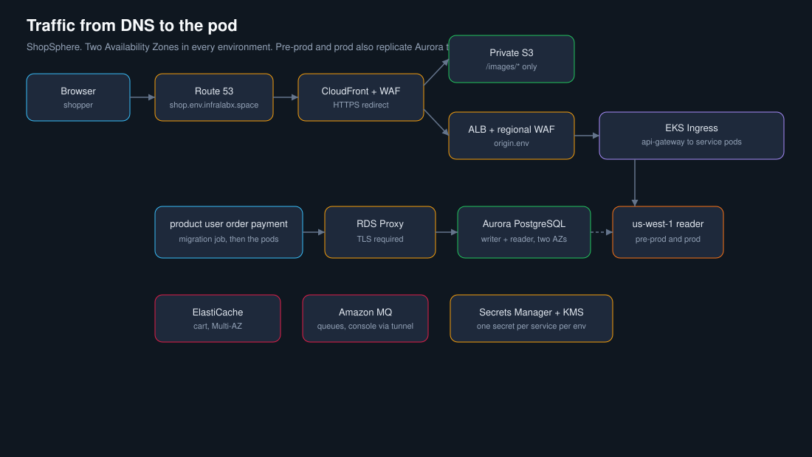
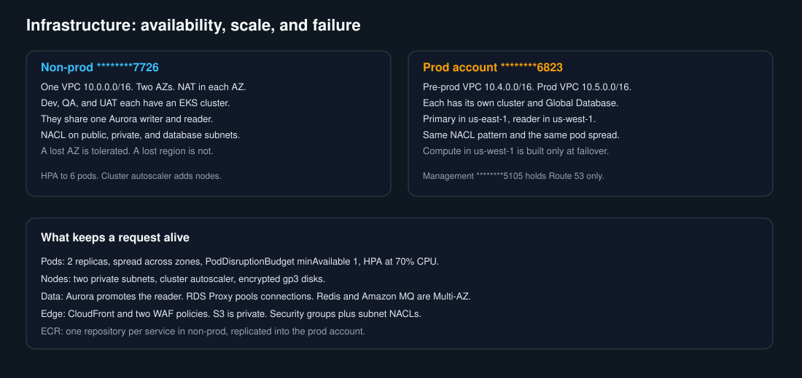
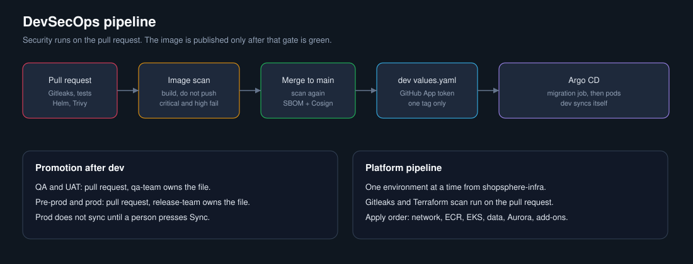
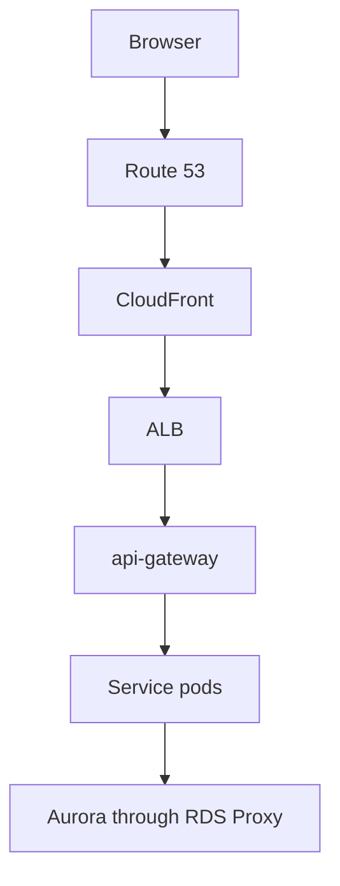

# ShopSphere

This repository is the original combined application chart. The running platform no longer deploys it as one release.

- Platform: [shopsphere-infra](https://github.com/Johnson9393/shopsphere-infra)
- One repository per service, each with its own chart and CI
- Desired state: [shopsphere-gitops](https://github.com/Johnson9393/shopsphere-gitops)
- Argo CD installs the per-service charts.

The platform is multi-AZ in every environment. Pre-prod and prod add an Aurora reader in `us-west-1`. Account numbers in docs show the last four digits only.
 The database bootstrap in `helm/shopsphere` remains the reference for how each environment's databases and logins are created.

# shopsphere
ShopSphere application, Helm, and GitHub Actions

Images and the private image buckets are copied to `us-west-1` as well as to the other account. Every environment rotates database, Redis, queue, and JWT passwords every 30 days with a Lambda. The application stores image URLs. It does not upload files, so there is no virus scan.
